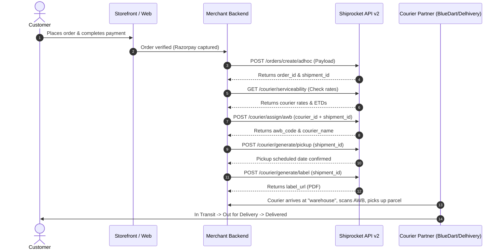

# Shiprocket Integration Master Handoff

> **Universal Developer & AI Agent Integration Guide**
> Complete operational specification for integrating Shiprocket domestic logistics into any e-commerce storefront or backend (Medusa, Next.js, Express, Shopify, or Custom Node.js).
> Grounded in live production implementation for **YOUNOYA** (`https://younoya.com`).

---

## 1. 🔑 Account Credentials & Server Environment

Configure these private credentials exclusively in your backend environment variables (`.env`). **Never expose these in client-side code or public GitHub repositories.**

```env
# Shiprocket API v2 Credentials
SHIPROCKET_API_BASE_URL=https://apiv2.shiprocket.in/v1/external
SHIPROCKET_API_EMAIL="order@younoya.com"
SHIPROCKET_API_PASSWORD="<set-on-backend-only>"

# Warehouse Pickup Configuration
SHIPROCKET_PICKUP_NICKNAME="warehouse"
```

### Verified Registered Pickup Facility Details
* **Pickup Location Nickname**: `warehouse` *(Must match character-for-character with Shiprocket settings)*
* **Registered Company**: `YOUNOYA HOUSE OF ASTRO PRIVATE LIMITED`
* **Address**: `B-86 basement, DTDC, South Delhi, Delhi 110024`
* **Pickup PIN**: `110024`
* **City / State**: `New Delhi, Delhi`
* **Country**: `India`
* **Account Status**: Verified (Status `2` active in Shiprocket)

---

## 2. 🔄 How to Send: Authentication & Token Lifecycle

Shiprocket API v2 uses **JWT Bearer Token** authentication. Tokens are valid for **10 days (240 hours)**.

### Authentication Flow
1. Make a `POST` request to `/v1/external/auth/login`.
2. Extract `data.token`.
3. Cache the token in memory or Redis for up to **9 days** (to refresh comfortably before expiration).
4. Send the header `Authorization: Bearer <token>` on all subsequent requests.
5. If any request returns `HTTP 401 Unauthorized`, purge the cached token and re-authenticate immediately.

#### Login Request
* **Endpoint**: `POST https://apiv2.shiprocket.in/v1/external/auth/login`
* **Headers**: `Content-Type: application/json`
* **Payload**:
```json
{
  "email": "order@younoya.com",
  "password": "<set-on-backend-only>"
}
```

#### Login Response
```json
{
  "id": 1234567,
  "first_name": "YOUNOYA",
  "last_name": "Atelier",
  "email": "order@younoya.com",
  "company_id": 987654,
  "created_at": "2026-10-09T10:00:00.000Z",
  "token": "eyJ0eXAiOiJKV1QiLCJhbGciOiJ..."
}
```

---

## 3. 📦 What to Send: Adhoc Order Creation (`POST /orders/create/adhoc`)

When an order is paid and approved for dispatch, send this payload to Shiprocket to create the shipping record and generate a `shipment_id`.

### Complete Verified Payload Schema

```json
{
  "order_id": "YOU-2026-0004",
  "order_date": "2026-10-09 16:30",
  "pickup_location": "warehouse",
  "channel_id": "",
  "comment": "Fragile luxury devotional gift box",
  "billing_customer_name": "Rakesh",
  "billing_last_name": "Kumar",
  "billing_address": "H-24, South Extension Part 1",
  "billing_address_2": "Near Metro Pillar 42",
  "billing_city": "New Delhi",
  "billing_pincode": "110049",
  "billing_state": "Delhi",
  "billing_country": "India",
  "billing_email": "customer@example.com",
  "billing_phone": "9810012345",
  "shipping_is_billing": true,
  "order_items": [
    {
      "name": "9 Days Navratri Shringaar Box",
      "sku": "YN-NAVRATRI-9D-001",
      "units": 1,
      "selling_price": 1499.00,
      "discount": 0,
      "tax": 0,
      "hsn": "62149090"
    }
  ],
  "payment_method": "Prepaid",
  "shipping_charges": 0.00,
  "giftwrap_charges": 0.00,
  "transaction_charges": 0.00,
  "total_discount": 0.00,
  "sub_total": 1499.00,
  "length": 33.02,
  "breadth": 22.86,
  "height": 8.89,
  "weight": 0.70
}
```

### Parameter Reference & Constraints Table

| Field | Type | Required? | Example Value | Rules & Operational Details |
| :--- | :---: | :---: | :--- | :--- |
| **`order_id`** | String | **Yes** | `"YOU-2026-0004"` | **Customer-facing order ID** displayed on checkout receipt. Do **NOT** send internal database UUIDs (e.g. `order_01M4G...`) so the customer tracking matches their receipt. |
| **`order_date`** | String | **Yes** | `"2026-10-09 16:30"` | Order creation timestamp in **IST (UTC+5:30)** format: `YYYY-MM-DD HH:mm`. |
| **`pickup_location`** | String | **Yes** | `"warehouse"` | Must match the **exact nickname** in Shiprocket Settings $\rightarrow$ Pickup Addresses. |
| **`billing_customer_name`** | String | **Yes** | `"Rakesh"` | Customer's first name. |
| **`billing_last_name`** | String | No | `"Kumar"` | Customer's surname (pass empty string `""` if single name). |
| **`billing_address`** | String | **Yes** | `"H-24, South Extension Part 1"` | Primary street address. Must be descriptive for courier dispatch. |
| **`billing_address_2`** | String | No | `"Near Metro Pillar 42"` | Apartment, suite, or landmark. |
| **`billing_city`** | String | **Yes** | `"New Delhi"` | Delivery city. |
| **`billing_pincode`** | String | **Yes** | `"110049"` | Valid 6-digit Indian Postal PIN code. |
| **`billing_state`** | String | **Yes** | `"Delhi"` | Indian State or Union Territory. |
| **`billing_country`** | String | **Yes** | `"India"` | Fixed value `"India"`. |
| **`billing_email`** | String | **Yes** | `"customer@example.com"` | Used for automatic delivery notifications and tracking SMS/emails. |
| **`billing_phone`** | String | **Yes** | `"9810012345"` | 10-digit Indian mobile number (without `+91` prefix). |
| **`shipping_is_billing`** | Boolean | **Yes** | `true` | Set to `true` when delivery address matches billing. |
| **`order_items`** | Array | **Yes** | `[{...}]` | Array of ordered items (see sub-fields below). |
| ↳ `name` | String | **Yes** | `"9 Days Navratri Shringaar Box"` | Product editorial title. |
| ↳ `sku` | String | **Yes** | `"YN-NAVRATRI-9D-001"` | Authentic inventory SKU. |
| ↳ `units` | Integer | **Yes** | `1` | Quantity ordered (minimum `1`). |
| ↳ `selling_price` | Number | **Yes** | `1499.00` | Unit price in **INR Rupees** (Major currency, NOT paise). |
| ↳ `hsn` | String | **Yes** | `"62149090"` | Valid Indian GST HSN code (`62149090` for traditional textiles/attire; `711790` for metal keepsakes). |
| **`payment_method`** | String | **Yes** | `"Prepaid"` | `"Prepaid"` (online via Razorpay/UPI/Card) or `"COD"` (Cash on Delivery). |
| **`shipping_charges`** | Number | **Yes** | `0.00` | Shipping fee charged in rupees (`0.00` for complimentary shipping, or `80.00` for COD). |
| **`sub_total`** | Number | **Yes** | `1499.00` | Net order total ($(\sum \text{selling\_price} \times \text{units}) + \text{shipping\_charges}$). Must match item totals exactly. |
| **`length`** | Number | **Yes** | `33.02` | Outer package length in **Centimeters (cm)**. *(13 inches = 33.02 cm)* |
| **`breadth`** | Number | **Yes** | `22.86` | Outer package width in **Centimeters (cm)**. *(9 inches = 22.86 cm)* |
| **`height`** | Number | **Yes** | `8.89` | Outer package height in **Centimeters (cm)**. *(3.5 inches = 8.89 cm)* |
| **`weight`** | Number | **Yes** | `0.70` | Dead weight in **Kilograms (kg)**. *(700 grams = 0.70 kg)* |

### Successful Adhoc Order Response
```json
{
  "order_id": 1641627893,
  "shipment_id": 1637597195,
  "status": "NEW",
  "status_code": 1,
  "onboarding_completed_now": 0,
  "awb_code": "",
  "courier_company_id": "",
  "courier_name": ""
}
```
> [!IMPORTANT]
> Save both **`order_id`** (Shiprocket's internal order key) and **`shipment_id`** (Shiprocket's package dispatch key) into your database.

---

## 4. 🚚 Complete Step-by-Step Fulfillment Lifecycle



### Step 1: Check Courier Serviceability & Rates
Check real-time rates and expected transit time (ETD) before assigning a courier.
* **Endpoint**: `GET https://apiv2.shiprocket.in/v1/external/courier/serviceability/`
* **Query Parameters**:
  * `pickup_postcode`: `110024`
  * `delivery_postcode`: Customer pincode (e.g. `110049`)
  * `cod`: `0` (Prepaid) or `1` (Cash on delivery)
  * `weight`: `0.70` (in kg)
  * `length`: `33.02` (in cm)
  * `breadth`: `22.86` (in cm)
  * `height`: `8.89` (in cm)
* **Response**:
```json
{
  "status": 200,
  "data": {
    "available_courier_companies": [
      {
        "courier_company_id": 24,
        "courier_name": "Delhivery Air",
        "rate": 78.50,
        "etd": "2-3 days",
        "rating": 4.5
      },
      {
        "courier_company_id": 48,
        "courier_name": "Blue Dart Express",
        "rate": 112.00,
        "etd": "1-2 days",
        "rating": 4.8
      }
    ]
  }
}
```

### Step 2: Assign AWB & Selected Courier
Assign an Air Waybill (AWB) to the created shipment.
* **Endpoint**: `POST https://apiv2.shiprocket.in/v1/external/courier/assign/awb`
* **Payload**:
```json
{
  "shipment_id": 1637597195,
  "courier_id": 24
}
```
* **Response**:
```json
{
  "awb_assign_status": 1,
  "response": {
    "data": {
      "shipment_id": 1637597195,
      "awb_code": "142189382190",
      "courier_company_id": 24,
      "courier_name": "Delhivery Air"
    }
  }
}
```

### Step 3: Schedule Courier Pickup
Tell the courier to dispatch a delivery driver to the warehouse.
* **Endpoint**: `POST https://apiv2.shiprocket.in/v1/external/courier/generate/pickup`
* **Payload**:
```json
{
  "shipment_id": [1637597195],
  "pickup_date": ["2026-10-16"]
}
```
* **Response**:
```json
{
  "pickup_status": 1,
  "response": {
    "pickup_scheduled_date": "2026-10-16 11:00:00",
    "pickup_token_number": "DEL_PK_987123"
  }
}
```

### Step 4: Download Shipping Documents (Print & Paste on Box)

#### A. Thermal Shipping Label (Barcoded Sticker)
* **Endpoint**: `POST https://apiv2.shiprocket.in/v1/external/courier/generate/label`
* **Payload**: `{ "shipment_id": [1637597195] }`
* **Response**: `{ "label_created": 1, "label_url": "https://s3.shiprocket.in/labels/1637597195.pdf" }`

#### B. Commercial GST Tax Invoice
* **Endpoint**: `POST https://apiv2.shiprocket.in/v1/external/orders/print/invoice`
* **Payload**: `{ "ids": [1641627893] }`
* **Response**: `{ "is_invoice_created": true, "invoice_url": "https://s3.shiprocket.in/invoices/1641627893.pdf" }`

#### C. Courier Handover Manifest
* **Endpoint**: `POST https://apiv2.shiprocket.in/v1/external/manifests/generate`
* **Payload**: `{ "shipment_id": [1637597195] }`
* **Response**: `{ "manifest_url": "https://s3.shiprocket.in/manifests/1637597195.pdf" }`

---

## 5. 🔍 Tracking, Webhooks & Status Normalization

Shiprocket status codes change as the package travels across India. Normalize these statuses into your store's database:

| Shiprocket Raw Status | Normalized Store Status | Customer Description |
| :--- | :--- | :--- |
| `NEW` / `READY TO SHIP` | `booked` | Order confirmed; carton packed in atelier |
| `AWB ASSIGNED` / `PICKUP SCHEDULED` | `booked` | Courier dispatched for pickup |
| `PICKED UP` | `picked_up` | Courier collected box from warehouse |
| `IN TRANSIT` / `REACHED AT DESTINATION` | `in_transit` | Flying / driving to customer city |
| `OUT FOR DELIVERY` | `in_transit` | On rider van/bike for final delivery today |
| `DELIVERED` | `delivered` | Successfully handed to customer |
| `RTO INITIATED` / `RTO DELIVERED` | `returned` | Undeliverable; returned to warehouse |
| `CANCELED` | `cancelled` | Order voided prior to courier pickup |

### Query Tracking Status
* **Endpoint**: `GET https://apiv2.shiprocket.in/v1/external/courier/track/awb/{awb_code}`
* Or by Shiprocket Order ID: `GET https://apiv2.shiprocket.in/v1/external/orders/show/{shiprocket_order_id}`

### Cancelling an Order
If a customer cancels before the courier picks it up:
* **Endpoint**: `POST https://apiv2.shiprocket.in/v1/external/orders/cancel`
* **Payload**: `{ "ids": [1641627893] }`

---

## 6. ⚠️ Critical Gotchas & Non-Negotiable Rules

1. **Units Must Be Metric**:
   * **Dimensions**: Always **Centimeters (cm)**. Never send inches! ($13\text{ in} \rightarrow 33.02\text{ cm}$).
   * **Weight**: Always **Kilograms (kg)**. Never send grams! ($700\text{ g} \rightarrow 0.70\text{ kg}$).
2. **Volumetric Weight Formula**:
   $$\text{Volumetric Weight (kg)} = \frac{\text{Length (cm)} \times \text{Breadth (cm)} \times \text{Height (cm)}}{5000}$$
   For the Navratri Box ($33.02 \times 22.86 \times 8.89\text{ cm}$), volumetric weight is **$1.342\text{ kg}$**. The courier charges for $1.342\text{ kg}$ even though dead weight is $0.70\text{ kg}$. Ensure your shipping margins account for this.
3. **Rupees vs. Paise Boundary**:
   * Shiprocket requires amounts in standard **INR Rupees** (e.g. `1499.00`).
   * Razorpay requires amounts in **Paise** (e.g. `149900`).
   * Never pass paise into Shiprocket's `selling_price` or `sub_total`, or you will bill ₹1,49,900!
4. **Idempotency (Prevent Duplicate Shipping Orders)**:
   * Before calling `/orders/create/adhoc`, search existing orders first:
     `GET /v1/external/orders?search={order_id}`
   * If an order with that `channel_order_id` or `order_id` already exists, reuse the existing `shipment_id` rather than creating a duplicate booking!
5. **Item Splitting for Paise Remainder**:
   * If dividing total order value by quantity produces repeating fractions (e.g. ₹100 / 3 items = ₹33.3333...), split items across two lines ($1 \times 33.34$, $2 \times 33.33$) so that:
     $$\sum (\text{selling\_price} \times \text{units}) \equiv \text{sub\_total}$$
     Shiprocket rejects orders where the line items sum does not exactly match `sub_total`.

---

## 7. 💻 Ready-to-Use TypeScript / Node.js Shiprocket Client

Drop this standalone class into your backend project (`shiprocket.ts`):

```typescript
import { setTimeout } from "timers/promises"

export interface ShiprocketOrderItem {
  name: string
  sku: string
  units: number
  selling_price: number
  hsn: string
}

export interface CreateShiprocketOrderPayload {
  order_id: string
  order_date: string
  pickup_location: string
  billing_customer_name: string
  billing_last_name: string
  billing_address: string
  billing_address_2?: string
  billing_city: string
  billing_pincode: string
  billing_state: string
  billing_country: string
  billing_email: string
  billing_phone: string
  shipping_is_billing: boolean
  order_items: ShiprocketOrderItem[]
  payment_method: "Prepaid" | "COD"
  shipping_charges: number
  sub_total: number
  length: number
  breadth: number
  height: number
  weight: number
}

export class ShiprocketClient {
  private token: string = ""
  private tokenExpiresAt: number = 0
  private baseUrl: string = "https://apiv2.shiprocket.in/v1/external"

  constructor(
    private email: string = process.env.SHIPROCKET_API_EMAIL || "order@younoya.com",
    private password: string = process.env.SHIPROCKET_API_PASSWORD || ""
  ) {}

  /**
   * Authenticate and cache JWT token for 9 days
   */
  private async getAuthToken(): Promise<string> {
    if (this.token && Date.now() < this.tokenExpiresAt) {
      return this.token
    }

    const response = await fetch(`${this.baseUrl}/auth/login`, {
      method: "POST",
      headers: { "Content-Type": "application/json" },
      body: JSON.stringify({ email: this.email, password: this.password })
    })

    if (!response.ok) {
      throw new Error(`Shiprocket login failed with HTTP status ${response.status}`)
    }

    const data = await response.json()
    if (!data.token) {
      throw new Error("Shiprocket login succeeded but no token was returned")
    }

    this.token = data.token
    // Cache for 9 days (token valid for 10)
    this.tokenExpiresAt = Date.now() + 9 * 24 * 60 * 60 * 1000
    return this.token
  }

  /**
   * Generic authorized API request
   */
  public async request<T = any>(path: string, method: string = "GET", body?: any): Promise<T> {
    const token = await this.getAuthToken()

    const response = await fetch(`${this.baseUrl}${path}`, {
      method,
      headers: {
        "Content-Type": "application/json",
        Authorization: `Bearer ${token}`
      },
      ...(body ? { body: JSON.stringify(body) } : {})
    })

    if (response.status === 401) {
      // Invalidate token on 401 and retry once
      this.token = ""
      this.tokenExpiresAt = 0
      return this.request(path, method, body)
    }

    if (!response.ok) {
      const errorText = await response.text()
      throw new Error(`Shiprocket API error [${response.status}] on ${path}: ${errorText}`)
    }

    return response.json()
  }

  /**
   * 1. Check Courier Serviceability & Rates
   */
  public async getServiceability(params: {
    pickupPincode: string
    deliveryPincode: string
    weightKg: number
    lengthCm: number
    widthCm: number
    heightCm: number
    isCod?: boolean
  }) {
    const query = new URLSearchParams({
      pickup_postcode: params.pickupPincode,
      delivery_postcode: params.deliveryPincode,
      weight: String(params.weightKg),
      length: String(params.lengthCm),
      breadth: String(params.widthCm),
      height: String(params.heightCm),
      cod: params.isCod ? "1" : "0"
    })

    const res = await this.request(`/courier/serviceability/?${query.toString()}`)
    return res.data?.available_courier_companies || []
  }

  /**
   * 2. Create Adhoc Order (Idempotent)
   */
  public async createAdhocOrder(payload: CreateShiprocketOrderPayload) {
    // Check if order already exists in Shiprocket
    const searchRes = await this.request(`/orders?search=${encodeURIComponent(payload.order_id)}`)
    if (Array.isArray(searchRes.data) && searchRes.data.length > 0) {
      const existing = searchRes.data.find(
        (o: any) => o.channel_order_id === payload.order_id || String(o.order_id) === payload.order_id
      )
      if (existing) {
        return {
          order_id: existing.id || existing.order_id,
          shipment_id: existing.shipment_id || existing.shipments?.[0]?.id,
          status: existing.status,
          is_duplicate: true
        }
      }
    }

    // Create fresh adhoc order
    return this.request("/orders/create/adhoc", "POST", payload)
  }

  /**
   * 3. Assign AWB to Shipment
   */
  public async assignAwb(shipmentId: number, courierCompanyId: number) {
    return this.request("/courier/assign/awb", "POST", {
      shipment_id: shipmentId,
      courier_id: courierCompanyId
    })
  }

  /**
   * 4. Schedule Courier Pickup
   */
  public async schedulePickup(shipmentId: number, pickupDateIso?: string) {
    const body: any = { shipment_id: [shipmentId] }
    if (pickupDateIso) {
      body.pickup_date = [pickupDateIso]
    }
    return this.request("/courier/generate/pickup", "POST", body)
  }

  /**
   * 5. Generate PDF Shipping Label URL
   */
  public async getLabelUrl(shipmentId: number): Promise<string> {
    const res = await this.request("/courier/generate/label", "POST", { shipment_id: [shipmentId] })
    return res.label_url
  }

  /**
   * 6. Generate PDF Invoice URL
   */
  public async getInvoiceUrl(shiprocketOrderId: number): Promise<string> {
    const res = await this.request("/orders/print/invoice", "POST", { ids: [shiprocketOrderId] })
    return res.invoice_url
  }

  /**
   * 7. Track AWB Status
   */
  public async trackAwb(awbCode: string) {
    return this.request(`/courier/track/awb/${awbCode}`)
  }

  /**
   * 8. Cancel Shipment
   */
  public async cancelOrder(shiprocketOrderId: number) {
    return this.request("/orders/cancel", "POST", { ids: [shiprocketOrderId] })
  }
}

// Canonical singleton export
export const shiprocket = new ShiprocketClient()
```
